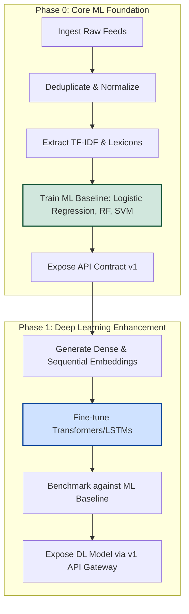

# Project Problem Definition: Automated Financial News Analysis and Market Sentiment Prediction

## 1. Executive Summary & Business Context

In modern financial markets, asset prices react to news, earnings announcements, analyst commentaries, and social media sentiment within milliseconds. Human analysts are physically constrained in their ability to read, comprehend, and synthesize the massive daily volume of unstructured financial text in real time. Consequently, institutional and individual investors face a high degree of information asymmetry and latent decision-making.

The business goal of this project is to develop an **Automated Financial News Analysis and Market Sentiment Prediction System** that ingests raw financial feeds and outputs structured, low-latency sentiment signals. These signals will serve as decision-support metrics to predict short-term market sentiment and subsequent stock price movements. 

To achieve this, the project is structured as a multi-phase development path. This document formally defines the first two phases: the **Core ML Foundation Phase** (establishing an interpretable baseline) and the **Phase 1 Deep Learning Enhancement** (maximizing predictive accuracy by capturing linguistic nuances and temporal dependencies).

---

## 2. Phase 0: Core ML Foundation Phase

The objective of the foundational phase is to establish a robust, interpretable, and reproducible machine learning pipeline that acts as the benchmark for all future upgrades.

### 2.1 Objectives
* **Primary Objective:** Build a machine learning classification system to categorize financial news articles and social media posts into three sentiment polarities: **Positive**, **Negative**, or **Neutral**.
* **Business Goal:** Link news sentiment polarity and confidence scores to short-term stock price direction and volatility, generating actionable trading signals.
* **Core Latency Target:** Ingestion, preprocessing, and classification must execute in **< 300 ms (p95)** via a synchronous REST API endpoint to enable high-frequency decision support.

### 2.2 Key Machine Learning Tasks
1. **Text Preprocessing Pipeline:** Tokenization, stop-word removal, lowercasing, and lemmatization tailored to financial domain vocabulary.
2. **Feature Engineering:** 
   * Statistical text features using Bag-of-Words (BoW) and Term Frequency-Inverse Document Frequency (TF-IDF).
   * Domain-specific lexicon features leveraging established financial lexicons (e.g., Loughran-McDonald sentiment dictionaries).
   * Keyword and entity indicators (e.g., ticker extraction, executive name presence).
3. **Multi-class Sentiment Classification:** Classification of unstructured text into `[Positive, Negative, Neutral]` labels.
4. **Scoring API Deployment:** Exposing a low-latency prediction endpoint that accepts a text payload and returns a JSON payload containing the predicted sentiment, probability distribution, and classification confidence.

### 2.3 Expected Machine Learning Algorithms
The development team will explore and benchmark the following supervised learning algorithms:
* **Logistic Regression:** Serves as a highly interpretable, fast baseline model using sparse TF-IDF matrices.
* **Support Vector Machines (SVM):** Evaluated with linear and radial basis function (RBF) kernels to find high-dimensional decision boundaries in text representations.
* **Decision Trees:** Explored to understand simple, rules-based hierarchical splits based on key financial terms.
* **Random Forest:** An ensemble of decision trees to reduce variance, improve generalization, and derive feature importance rankings.
* **Gradient Boosting (e.g., XGBoost / LightGBM):** Evaluated for boosting weak decision trees to minimize training loss and capture non-linear feature interactions.

### 2.4 Data Requirements
* **Input Data:** Structured historical financial news articles (headlines and bodies), press releases, and social media posts.
* **Labels:** Ground-truth sentiment labels (manually annotated validation set combined with weak supervision using financial lexicons or forward returns as proxies).
* **Market Alignment:** Historical intraday and end-of-day price data (open, close, high, low, volume) for mentioned tickers, timestamp-aligned to the news release event.
* **Data Cleaning & Scaling:** Deduplication of syndicated wire reports, timezone normalization across markets/sources, handling of missing price ticks, and standard scaling of engineered numerical features.
* **Imbalance Handling:** Stratified sampling or class-weighting (e.g., SMOTE or cost-sensitive learning) to address the typical bias toward neutral or positive news in financial corpora.

### 2.5 Baseline Performance Metrics
All models will be evaluated using a held-out test dataset, and metrics must be reported overall and broken out per class (Positive, Negative, Neutral) using a One-vs-Rest (OvR) approach:
* **Accuracy:** Overall proportion of correctly classified news items.
* **Precision:** Ratio of true positives to total predicted positives per class, critical for minimizing false positives (e.g., avoiding acting on a false "positive" sentiment signal).
* **Recall:** Ratio of true positives to actual positives per class, ensuring the system does not miss market-moving news.
* **F1-Score (Macro & Weighted):** The harmonic mean of precision and recall to balance model performance across imbalanced classes.
* **ROC-AUC (Receiver Operating Characteristic - Area Under Curve):** Measures the model's ability to distinguish between classes at various threshold settings.

### 2.6 Phase Success Criteria
* **Model Validation:** The chosen baseline model must outperform a simple dummy classifier (majority class prediction) by at least **15%** in macro F1-score.
* **Ingestion/Latency:** The scoring API must achieve a p95 latency of **< 300 ms** under a simulated load of 50 requests per second.
* **Interpretability:** Production of stable feature importance tables and SHAP values indicating the top financial terms driving classification.

---

## 3. Phase 1: Deep Learning Enhancement

The objective of the deep learning phase is to move beyond statistical frequency of words and capture contextual meaning, linguistic sequence, and temporal relationships.

### 3.1 Objectives
* **Primary Objective:** Upgrade the sentiment prediction engine to evaluate complex grammatical structures, contextual meanings, and temporal sequences of news sentiment leading up to market events.
* **Advanced Capabilities:**
   * **Complex Linguistic Patterns:** Capture negation (e.g., "not bad"), sarcasm, and financial hedging (e.g., "could indicate potential underperformance, although unlikely").
   * **Temporal Dependencies:** Understand how sequences of news items over a rolling window (e.g., hours or days) cumulatively affect market reaction.
   * **Subtle Emotional Cues:** Distinguish between neutral reporting and highly speculative/emotional language in social media or analyst reports.
   * **Influential Entity Identification:** Link sentiment to specific tickers, executives, or product lines within multi-ticker articles.

### 3.2 Deep Learning Architectures to Evaluate
* **Multi-Layer Perceptron (MLP):** Serving as a simple feed-forward neural baseline using dense token embeddings.
* **Convolutional Neural Networks (CNN for NLP):** Explored to capture local n-gram features and spatial patterns across sentence fragments.
* **Recurrent Neural Networks (RNN) & Long Short-Term Memory (LSTM):** Evaluated for processing sequence data, addressing the vanishing gradient problem, and tracking temporal sentiment trends over rolling time-series windows.
* **Transformer-Based Models:** Fine-tuning pre-trained, state-of-the-art architectures (e.g., `FinBERT`, `BERT-base`) using transfer learning to leverage deep contextual embeddings trained on financial corpora.

### 3.3 Data Requirements
* **Sequential Processing:** Data must be represented as chronologically ordered sequences of tokens or rolling windows of news events.
* **Subword Tokenization:** Transitioning from word-level stems to Byte-Pair Encoding (BPE) or WordPiece tokenizers to handle out-of-vocabulary financial terms.
* **Contextual & Dense Embeddings:** Utilization of dense pre-trained word embeddings (e.g., GloVe, Word2Vec) or contextual token embedding tensors output by Transformer layers.
* **Tensor Representations:** Text converted into padded, fixed-length sequence tensors ready for GPU-accelerated tensor operations.
* **Compute Infrastructure:** Access to GPU resources for model training, optimization, and backpropagation.

### 3.4 Performance Comparison & Benchmarking
* **Baseline Benchmarking:** The DL model must be tested on the exact same train/test split as the Phase 0 ML baseline.
* **Improvement Tracking:** Generate performance delta tables showing changes in F1-score, Precision, Recall, and ROC-AUC.
* **Loss & Accuracy Curves:** Document training vs. validation loss/accuracy across epochs to track convergence and prevent overfitting.
* **Attention Visualizations:** For Transformer models, produce heatmaps of self-attention weights to verify that the model is focusing on relevant financial concepts and entities.

### 3.5 Phase Success Criteria
* **Accuracy Uplift:** The deep learning model must show a statistically significant improvement of **>= 5% absolute increase in macro F1-score** compared to the best Core ML model.
* **Generalization:** Demonstrate stable validation loss curves with early stopping, dropout regularization, and weight decay preventing overfitting.
* **API Compatibility:** The DL model must slot into the existing REST API contract defined in Phase 0, serving predictions via a model-version flag while maintaining acceptable latency targets (< 500 ms p95 for the DL model).

---

## 4. Technical and Business Challenges

Developing this system requires resolving several key challenges across both engineering and mathematical modeling domains:

| Category | Challenge | Description | Mitigation Strategy |
| :--- | :--- | :--- | :--- |
| **Technical** | **Data Leakage** | Accidentally incorporating future market information (post-event stock returns) into features during model training. | Strict temporal splitting of training, validation, and test datasets; time-boundary checks in feature pipelines. |
| **Technical** | **Class Imbalance** | Financial news contains a high proportion of "neutral" or moderately positive articles, with relatively few "negative" panic events. | Implement weighted loss functions, cost-sensitive learning, and stratified splits across sentiment labels. |
| **Technical** | **Domain-Specific Jargon** | General language models misinterpret words like "bullish", "bearish", "execution", or "yield". | Prioritize financial-domain embeddings (`FinBERT`) and lexicons (Loughran-McDonald). |
| **Technical** | **Latency vs. Complexity** | Transformers provide superior accuracy but introduce high inference latency, threatening real-time utility. | Evaluate model quantization (FP16/INT8), distillation, or serving via optimized runtimes (ONNX/TensorRT). |
| **Business** | **Noise-to-Signal Ratio** | The majority of financial chatter contains irrelevant noise or repetitive syndication that does not move markets. | Robust deduplication, source reputation weighting, and strict Named Entity Recognition constraints. |
| **Business** | **Market Regime Shifts** | Relationships between sentiment and stock movements change during bull markets, bear markets, and high-volatility regimes. | Continuous model monitoring, sliding-window training, and validation across multiple historical market regimes. |

---

## 5. Development Progression & Roadmap

* **Rationale for the Sequence:** By starting with a traditional ML approach, we quickly deliver a working end-to-end data pipeline, define the system's API contracts, and deploy a lightweight baseline. This baseline serves as a direct point of comparison. Deep Learning models are then introduced only after the data pipeline and verification metrics are fully stabilized, ensuring that the team can mathematically prove the return on investment (ROI) of introducing computationally expensive neural network architectures.
