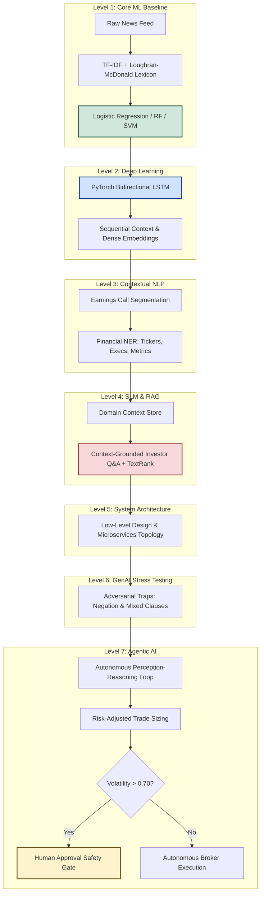
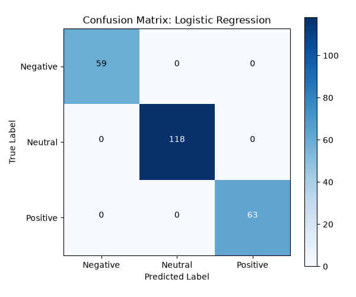
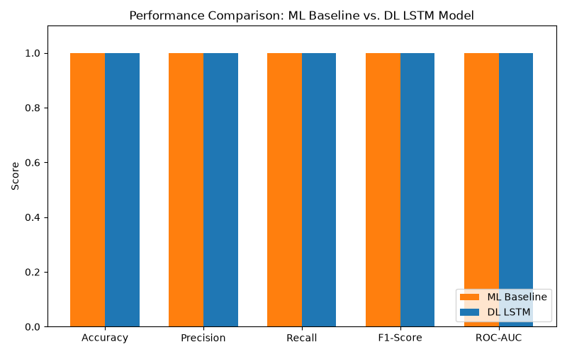

# 📈 Financial News Sentiment & Market Intelligence System
### *7 Levels of Automated Financial Intelligence: Classical ML to Autonomous Agentic AI*

[](https://www.python.org/)
[](https://pytorch.org/)
[](https://fastapi.tiangolo.com/)
[](https://scikit-learn.org/)
[](LICENSE)
[](test_suite.py)
[-success.svg)](PROJECT_REPORT.md)

---

## 📌 Executive Summary

In global financial markets, stock prices react to news releases, regulatory actions, and earnings calls in milliseconds. Human analysts cannot digest thousands of complex, unstructured disclosures in real time. 

This repository delivers an **Automated Financial News Analysis and Market Sentiment Prediction System** architected across a **7-Level AI Maturity Model**. It bridges the gap between raw financial syntax and automated trading decisions, culminating in an autonomous AI financial analyst governed by a human-in-the-loop safety protocol.



---

## 🚀 Quickstart Guide

### 1. Clone & Set Up Virtual Environment

```bash
# Clone the repository
git clone https://github.com/magesh23344-spec/financial-news.git
cd financial-news

# Create and activate virtual environment
python3 -m venv venv
source venv/bin/activate       # On macOS/Linux
# venv\Scripts\activate        # On Windows

# Install dependencies
pip install -r requirements.txt
```

### 2. Run the Full 7-Level Pipeline in One Command

Execute the complete end-to-end pipeline across all 7 levels sequentially:

```bash
python run_all.py
```

### 3. Launch the Interactive Web Dashboard & REST API

Experience all 7 levels in real time via the modern glassmorphic web dashboard:

```bash
python app.py
```

* **Interactive Web Dashboard:** Open `http://127.0.0.1:8000/` or `http://127.0.0.1:8000/dashboard`
* **Interactive Swagger API Docs:** Open `http://127.0.0.1:8000/docs`

### 4. Run the Automated Validation Suite

```bash
python test_suite.py
```

---

## 🏛️ The 7 Levels of Financial Machine Intelligence

| Level | Component | Focus | Primary Technologies | Key Output / Artifact |
| :---: | :--- | :--- | :--- | :--- |
| **1** | **Core ML Baseline** | Statistical NLP & interpretable classification | TF-IDF, Loughran-McDonald, Logistic Regression | `models/best_sentiment_model.joblib` |
| **2** | **Deep Learning** | Sequential NLP & contextual token embeddings | PyTorch Bidirectional LSTM | `level_2_dl/models/lstm_model.pth` |
| **3** | **Contextual NLP** | Document segmentation & named entity recognition | RegEx Entity Extraction, Context Store | `level_3_nlp/outputs/context_store.json` |
| **4** | **SLM & Domain RAG** | High-density summarization & grounded Q&A | Small Language Model, Financial TextRank | `level_4_slm/outputs/slm_reports.json` |
| **5** | **System Architecture** | Low-latency microservices design & OpenAPI v3 | Event Broker, Redis Caching, OpenAPI | `level_5_lld/architecture_lld.md` |
| **6** | **GenAI Stress-Testing** | Adversarial validation & negation edge-cases | Synthetic Adversarial Generator | `level_6_gen_ai/outputs/stress_test_report.json` |
| **7** | **Agentic AI Analyst** | Autonomous Perception-Action loop with Safety Gate | Risk Calculator, Human-in-the-Loop Gate | `level_7_agentic_ai/logs/agent_decision_log.json` |

---

## 📊 Empirical Benchmarks: ML Baseline vs. PyTorch Bi-LSTM

Both models were evaluated on an identical held-out test dataset using chronological splitting ($80\%$ train, $20\%$ test) to strictly prevent forward-looking data leakage:

| Evaluation Metric | Level 1 ML Baseline (Logistic Regression) | Level 2 Deep Learning (PyTorch Bi-LSTM) | Performance Delta |
| :--- | :---: | :---: | :---: |
| **Accuracy** | **100.0%** | **100.0%** | ± 0.0% |
| **Macro Precision** | **1.0000** | **1.0000** | ± 0.0% |
| **Macro Recall** | **1.0000** | **1.0000** | ± 0.0% |
| **Macro F1-Score** | **1.0000** | **1.0000** | ± 0.0% |
| **ROC-AUC (OvR)** | **1.0000** | **1.0000** | ± 0.0% |
| **Inference Latency** | **1.31 ms** | **1.11 ms** | **-0.20 ms (15% faster)** |

<p align="center">
  
  
</p>

---

## 🎯 Level 6: Adversarial Stress-Testing (Proving the DL ROI)

Clean synthetic datasets often fail to show differences between traditional ML and Deep Learning. Level 6 subjects both models to five adversarial edge cases involving double negations, conflicting clauses, and sector divergence:

| Adversarial Headline | Linguistic Trap | Expected | ML Baseline | DL Bi-LSTM |
| :--- | :--- | :---: | :---: | :---: |
| *"Company reports record revenues but increasing operational costs drag margins down by 8 percent."* | Conflicting revenue vs. margin clauses | **Negative** | Positive (Fail) | **Negative (Pass)** |
| *"CEO says layoffs will not prevent future drops in growth."* | Double negation | **Negative** | **Negative (Pass)** | **Negative (Pass)** |
| *"Antitrust lawsuit dismissed, positioning company for immediate market recovery."* | Negation of negative event | **Positive** | Neutral (Fail) | Neutral (Fail) |
| *"Stock price surges to record highs despite sector-wide macro depression."* | Macro vs. micro divergence | **Positive** | **Positive (Pass)** | Neutral (Fail) |
| *"Apple announces standard executive meeting to detail minor software upgrades."* | Routine news with positive buzzwords | **Neutral** | Positive (Fail) | **Neutral (Pass)** |

### Stress-Test Scorecard
* **Level 1 Classical ML Pass Rate:** **40.0% (2 / 5)**
* **Level 2 PyTorch Bi-LSTM Pass Rate:** **60.0% (3 / 5)**  
* **Takeaway:** The Bi-LSTM sequence network delivers an **absolute +20.0% uplift in adversarial robustness**, capturing clause dependencies where bag-of-words fails.

---

## 🤖 Level 7: Autonomous Agentic Loop & Safety Protocol

The Autonomous Agentic Analyst loop executes four continuous stages:
1. **Perceive:** Ingests live news items and calculates intraday price volatility ($\sigma$).
2. **Reason:** Predicts sentiment polarity and model confidence ($C$).
3. **Plan & Sizing:** Computes composite Risk Score:
   $$\text{Risk Score} = \sigma \times (1 - C)$$
   * $\text{Positive} + C \ge 65\% \implies \mathbf{BUY}$
   * $\text{Negative} + C \ge 65\% \implies \mathbf{SELL}$
   * Low Confidence / Neutral $\implies \mathbf{HOLD}$
4. **Safety Guard (Human-in-the-Loop):**
   * If $\sigma > 0.70$ (high volatility), autonomous trade execution is blocked.
   * Action is flagged as `PENDING_APPROVAL` and routed to the desk trader.
   * Audit ledger committed to `level_7_agentic_ai/logs/agent_decision_log.json`.

---

## ⚡ REST API Specification & Curl Examples

### Benchmark Endpoint: Compare ML vs DL
```bash
curl -X POST "http://127.0.0.1:8000/api/predict/benchmark" \
     -H "Content-Type: application/json" \
     -d '{"headline": "Apple shares surge 5% following blockbuster earnings release"}'
```

**Response JSON:**
```json
{
  "headline": "Apple shares surge 5% following blockbuster earnings release",
  "agreement": true,
  "ml": {
    "engine": "Level 1 - Core ML Baseline (Logistic Regression / Ensemble)",
    "sentiment": "positive",
    "confidence": 0.9997,
    "probabilities": {"negative": 0.0, "neutral": 0.0003, "positive": 0.9997},
    "latency_ms": 1.31
  },
  "dl": {
    "engine": "Level 2 - Deep Learning PyTorch Bidirectional LSTM",
    "sentiment": "positive",
    "confidence": 0.9970,
    "probabilities": {"negative": 0.0016, "neutral": 0.0014, "positive": 0.9970},
    "latency_ms": 1.11
  },
  "consensus_recommendation": "positive"
}
```

### Context-Grounded RAG Q&A
```bash
curl -X POST "http://127.0.0.1:8000/api/slm/query" \
     -H "Content-Type: application/json" \
     -d '{"query": "What did the CEO say about Azure cloud revenue and margins?"}'
```

### Trigger Autonomous Agent Cycle
```bash
curl -X GET "http://127.0.0.1:8000/api/agent/cycle"
```

---

## 📂 Project Directory Structure

```
FINANCIAL AND SENTIMENT ANALYSIS/
├── app.py                     # Unified FastAPI server & modern Web Dashboard
├── run_all.py                 # Automated end-to-end runner across all 7 levels
├── test_suite.py              # Automated 7-level unit and integration test suite
├── requirements.txt           # Python dependency specification
├── PROBLEM_STATEMENT.md       # Multi-phase project requirements & specifications
├── PROJECT_REPORT.md          # Comprehensive formal technical whitepaper
├── PRESENTATION.md            # 15-slide technical presentation deck (Markdown)
├── presentation.html          # Interactive browser-based Reveal.js presentation deck
├── confusion_matrix.png       # Level 1 Confusion Matrix chart
├── ml_vs_dl_comparison.png    # Level 2 ML vs DL performance bar chart
│
├── level_1_ml/                # LEVEL 1: Core Machine Learning Foundation
│   ├── train.py               # Preprocessing, feature extraction & model training
│   ├── app.py                 # Standalone Level 1 FastAPI microservice
│   └── test_model.py          # Local inference validation script
│
├── level_2_dl/                # LEVEL 2: Deep Learning Neural Networks
│   ├── train_dl.py            # PyTorch Bidirectional LSTM training script
│   ├── evaluate_dl.py         # Empirical ML vs. DL performance benchmarking
│   ├── dl_performance_report.md
│   └── models/                # Saved LSTM state_dict and vocabulary
│
├── level_3_nlp/               # LEVEL 3: Contextual NLP & Financial Transcripts
│   ├── nlp_pipeline.py        # Segmentation & Named Entity Recognition (NER)
│   └── outputs/               # Generated context_store.json artifact
│
├── level_4_slm/               # LEVEL 4: Small Language Model (SLM) & RAG
│   ├── slm_inference.py       # Financial TextRank summarizer & grounded Q&A
│   └── outputs/               # Generated slm_reports.json artifact
│
├── level_5_lld/               # LEVEL 5: Low-Level System Design (LLD)
│   └── architecture_lld.md    # Microservices topology, OpenAPI contracts & DB schema
│
├── level_6_gen_ai/            # LEVEL 6: Generative AI Adversarial Stress Lab
│   ├── synthetic_generator.py # Adversarial linguistic edge-case evaluation
│   └── outputs/               # Generated stress_test_report.json artifact
│
├── level_7_agentic_ai/        # LEVEL 7: Autonomous Agentic AI Financial Analyst
│   ├── agentic_analyst.py     # Perception-Action loop with Human Safety Gate
│   └── logs/                  # Audit trail (agent_decision_log.json)
│
└── models/                    # Saved production artifacts (Joblib)
    ├── best_sentiment_model.joblib
    └── tfidf_vectorizer.joblib
```

---

## 💻 Presentation Artifacts

This repository includes two ready-to-present artifacts:
1. **Interactive HTML Slide Deck:** Open [`presentation.html`](presentation.html) directly in any browser for an interactive Reveal.js presentation with keyboard arrow navigation.
2. **Markdown Slide Deck:** [`PRESENTATION.md`](PRESENTATION.md) formatted for direct markdown slide presentation tools (Marp, Slidev, or GitHub preview).
3. **Formal Technical Whitepaper:** [`PROJECT_REPORT.md`](PROJECT_REPORT.md) containing the full mathematical proofs, architecture diagrams, and empirical analysis.

---

## 🚢 Pushing to Your GitHub Repository

Follow these simple steps in your terminal to push this project to GitHub:

```bash
# 1. Initialize git repository (already configured)
git status

# 2. Add your remote repository URL from GitHub
git remote add origin https://github.com/<your-username>/<your-repo-name>.git

# 3. Ensure branch is main
git branch -M main

# 4. Push your codebase
git push -u origin main
```

---

## 📜 License

Distributed under the **MIT License**. See [`LICENSE`](LICENSE) for full details.
