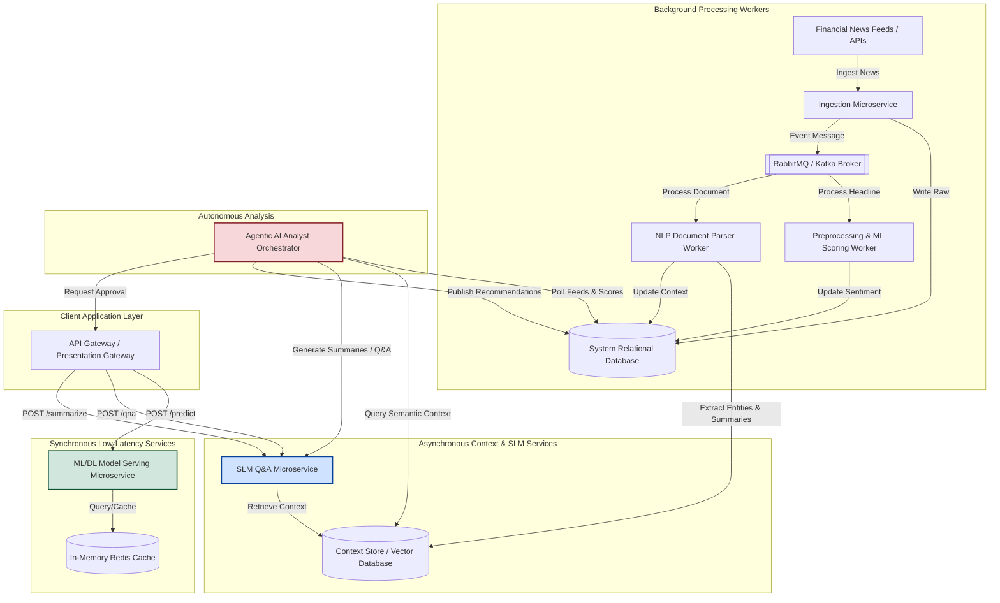
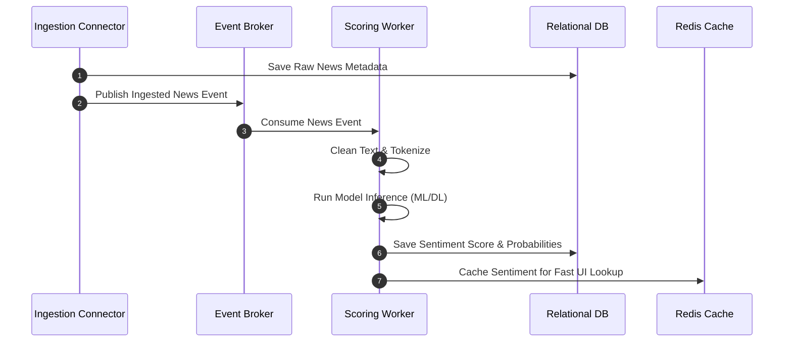
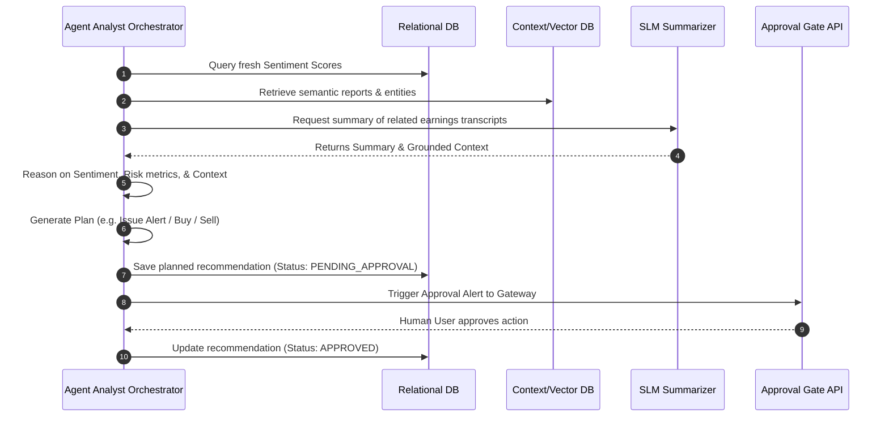

# Low-Level Design: Automated Financial News Analysis and Market Sentiment Prediction System

This document specifies the architecture, components, data models, and API interfaces designed to support a multi-layered financial intelligence system spanning traditional ML scoring, PyTorch Deep Learning pipelines, NLP entity extraction, SLM RAG agents, and autonomous Agentic AI loops.

---

## 1. System Architecture

The system is constructed of independent microservices coordinating through RESTful APIs and asynchronous event brokers to ensure low latency for model scoring and high reliability for background workloads.



---

## 2. API Contract Specifications (OpenAPI v3)

### 2.1 Synchronous Sentiment Prediction Endpoint
* **Endpoint:** `POST /v1/predict`
* **Content-Type:** `application/json`
* **Request Payload Schema:**
```json
{
  "title": "API Request payload",
  "type": "object",
  "properties": {
    "headline": {
      "type": "string",
      "description": "Raw text of the headline to analyze."
    },
    "model_version": {
      "type": "string",
      "default": "dl_lstm_v1",
      "description": "Selected model engine: ml_baseline_v1 or dl_lstm_v1."
    }
  },
  "required": ["headline"]
}
```
* **Response Payload Schema (200 OK):**
```json
{
  "headline": "Apple shares surge 5% following blockbuster earnings release",
  "sentiment": "positive",
  "confidence": 0.8921,
  "probabilities": {
    "negative": 0.0245,
    "neutral": 0.0834,
    "positive": 0.8921
  },
  "model_engine": "dl_lstm_v1",
  "processed_at": "2026-08-07T11:27:00Z"
}
```

### 2.2 Asynchronous Document Summarization Endpoint
* **Endpoint:** `POST /v1/summarize`
* **Content-Type:** `application/json`
* **Request Payload Schema:**
```json
{
  "document_text": "Full text of the earnings call transcript or analyst report...",
  "ticker_reference": "MSFT"
}
```
* **Response Payload Schema (202 Accepted):**
```json
{
  "task_id": "task_abc123xyz",
  "status": "processing",
  "estimated_duration_sec": 3.5
}
```

---

## 3. Relational Database & Context Store Schema

```mermaid
erDiagram
    NEWS_ARTICLES ||--|| SENTIMENT_SCORES : "has score"
    NEWS_ARTICLES ||--o{ EXTRACTED_ENTITIES : "contains"
    NEWS_ARTICLES }o--|| COMPANIES : "references"
    RECOMMENDATIONS }o--|| SENTIMENT_SCORES : "generated from"
    RECOMMENDATIONS }o--|| COMPANIES : "targets"

    NEWS_ARTICLES {
        bigint id PK
        varchar headline
        text body_text
        timestamp published_at
        varchar source
        boolean is_synthetic
    }

    SENTIMENT_SCORES {
        bigint id PK
        bigint article_id FK
        varchar sentiment_label
        double confidence
        double prob_positive
        double prob_negative
        double prob_neutral
        varchar model_engine
    }

    EXTRACTED_ENTITIES {
        bigint id PK
        bigint article_id FK
        varchar entity_type
        varchar entity_value
        double confidence_score
    }

    COMPANIES {
        bigint id PK
        varchar ticker UNIQUE
        varchar name
        varchar sector
    }

    RECOMMENDATIONS {
        bigint id PK
        bigint company_id FK
        varchar recommendation_type
        text rationale
        double risk_score
        boolean human_approved
        varchar status
        timestamp created_at
    }
```

---

## 4. Sequence Diagrams

### 4.1 Real-Time News Ingestion & Scoring Flow


### 4.2 Autonomous Agentic Decision Sequence

